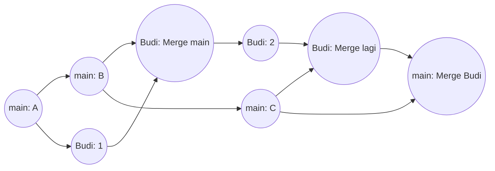

# 🌿 Panduan Kolaborasi Git Tim: Strategi `merge --no-ff` & `rebase`

> **Modul Pembelajaran Siswa / Developer**  
> **Topik**: Standar Industri *Feature Branch Workflow* dengan *Semi-Linear History*  
> **Target**: Memahami cara kerja tim software engineering profesional agar riwayat kode rapi, aman di *Production*, dan minim konflik (*conflict*).

---

## 🎯 1. Konsep Dasar: Mengapa Pola Ini Adalah *Best Practice*?

Dalam dunia industri pengembangan perangkat lunak (seperti di GitLab, GitHub, dan perusahaan teknologi), pola kerja yang Anda pelajari ini disebut **Feature Branch Workflow dengan Semi-Linear History**.

Aturan emasnya sangat sederhana:

1. **Branch `main` adalah Suci (*Production-Ready*)**:
   * Kode yang ada di `main` adalah kode yang **100% stabil, sudah dites, dan siap/sedang tayang di server Production**.
   * **DILARANG KERAS** melakukan coding atau *commit* langsung di branch `main`.
2. **Setiap Anggota Tim Bekerja di Branch Masing-Masing (*Feature Branch*)**:
   * Setiap siswa/developer membuat branch sendiri sesuai fitur yang dikerjakan (contoh: `feat/login`, `feat/keranjang-belanja`, `fix/cetak-struk`).
3. **Ketua Tim (*Team Lead*) Menggabungkan ke `main` dengan `merge --no-ff`**:
   * Ketika fitur seorang anggota selesai dan lolos pemeriksaan (*Code Review*), Ketua Tim menggabungkannya ke `main` menggunakan flag `--no-ff` (*No Fast-Forward*).
   * **Kenapa `--no-ff`?** Agar Git selalu membuat **1 titik simpul khusus (*Merge Commit*)**. Jika suatu saat fitur tersebut membuat server *error*, Ketua Tim cukup membatalkan (*revert*) 1 titik *merge* tersebut tanpa merusak kode orang lain!
4. **Anggota Lain Wajib Melakukan `rebase` Terhadap `main` Terbaru**:
   * Begitu `main` diperbarui oleh Ketua Tim, anggota lain yang masih mengerjakan tugasnya di branch masing-masing wajib menarik pembaruan `main` lalu melakukan **`git rebase main`**.
   * **Kenapa `rebase` (bukan `merge`)?** Karena `rebase` memindahkan pondasi branch anggota ke atas `main` yang paling baru. Hasilnya, riwayat *commit* tetap lurus seperti garis kereta api, tidak kusut seperti benang ruwet (*spaghetti history*).

---

## 📊 2. Visualisasi Perbedaan: Tanpa Aturan vs *Best Practice*

### ❌ Cara yang Salah (Semua Orang Asal `git pull` & `git merge` Bolak-Balik)
Jika anggota tim tidak menggunakan `rebase` di branch masing-masing, riwayat Git akan terlihat kusut dan sulit dilacak saat ada bug:



### ✅ Cara *Best Practice* (`rebase` untuk Anggota + `merge --no-ff` untuk Ketua Tim)
Pondasi setiap fitur selalu berpijak pada `main` terbaru, dan setiap fitur yang masuk ke `main` tercatat jelas sebagai satu kubah fitur:

```mermaid
flowchart LR
    subgraphMAIN ["Branch main (Production)"]
        A((Commit Awal)) --> B((Merge Fitur Andi<br>--no-ff))
        B --> C((Merge Fitur Siti<br>--no-ff))
    end

    subgraphANDI ["Branch feat/auth (Andi)"]
        A --> A1((Buat Form Login))
        A1 --> A2((Validasi Password))
        A2 --> B
    end

    subgraphSITI ["Branch feat/produk (Siti - Setelah Rebase ke B)"]
        B -. "Siti melakukan<br>git rebase origin/main" .-> S1((Tabel Produk))
        S1 --> S2((Tambah Foto Produk))
        S2 --> C
    end

    style A fill:#1e293b,stroke:#475569,color:#fff
    style B fill:#15803d,stroke:#22c55e,stroke-width:2px,color:#fff
    style C fill:#15803d,stroke:#22c55e,stroke-width:2px,color:#fff
    style A1 fill:#0369a1,stroke:#38bdf8,color:#fff
    style A2 fill:#0369a1,stroke:#38bdf8,color:#fff
    style S1 fill:#7e22ce,stroke:#c084fc,color:#fff
    style S2 fill:#7e22ce,stroke:#c084fc,color:#fff
```

---

## 🎬 3. Studi Kasus Nyata: Proyek "Kasir Pintar Sekolah"

Mari kita simulasikan kerja tim di kelas yang terdiri dari **3 orang**:
* 👨‍💼 **Raka (Ketua Tim / Lead Developer)**: Bertugas menjaga kualitas branch `main` (Production).
* 👨‍💻 **Andi (Anggota 1 - Backend)**: Bertugas membuat fitur **Halaman Login (`feat/login`)**.
* 👩‍💻 **Siti (Anggota 2 - Frontend)**: Bertugas membuat fitur **Katalog Barang (`feat/katalog`)**.

---

### Babak 1: Semua Anggota Memulai dari `main` yang Sama (Senin Pagi)

Pada hari Senin pukul 08.00, di repository utama (`origin/main`) baru ada kerangka dasar proyek (Commit `A`).

**1. Andi membuat branch kerjanya sendiri:**
```bash
# Pastikan berada di main terbaru
git checkout main
git pull origin main

# Buat branch baru untuk fitur login
git checkout -b feat/login
```
Andi mulai ngoding, lalu menyimpan pekerjaannya:
```bash
git add .
git commit -m "feat(auth): membuat halaman dan controller login"
git push -u origin feat/login
```

**2. Di saat yang bersamaan, Siti juga membuat branch kerjanya sendiri:**
```bash
git checkout main
git pull origin main

# Buat branch baru untuk fitur katalog
git checkout -b feat/katalog
```
Siti mulai ngoding halaman katalog barang:
```bash
git add .
git commit -m "feat(katalog): membuat tabel daftar barang"
```
*(Siti masih belum selesai, dia masih lanjut mengerjakan fitur pencarian barang).*

---

### Babak 2: Andi Selesai Lebih Dulu & Ketua Tim Melakukan `merge --no-ff` (Senin Siang)

Pada pukul 13.00, fitur Login milik **Andi** sudah selesai 100% dan sudah dites berjalan lancar. Andi melapor ke **Raka (Ketua Tim)**.

**Apa yang dilakukan Raka (Ketua Tim)?**
Raka memeriksa kode Andi, lalu menggabungkannya ke `main` menggunakan **`--no-ff`**:

```bash
# 1. Raka pindah ke branch main dan tarik update terbaru
git checkout main
git pull origin main

# 2. Ambil data branch terbaru dari server
git fetch origin

# 3. Gabungkan branch Andi ke main dengan --no-ff (No Fast-Forward)
git merge --no-ff origin/feat/login -m "Merge branch 'feat/login' (Andi) into main"

# 4. Push main terbaru ke server (Production ter-update!)
git push origin main
```

> [!TIP]
> **Apa efek perintah `git merge --no-ff` yang dijalankan Raka?**  
> Meskipun di `main` belum ada perubahan lain sejak Senin pagi, Git **tidak akan meleburkan** commit Andi begitu saja, melainkan membuat **1 commit penanda khusus**: `"Merge branch 'feat/login' (Andi) into main"`. Dengan begitu, di buku sejarah proyek tercatat jelas kapan fitur Andi resmi masuk ke Production.

Setelah itu, Raka mengumumkan di grup chat tim:
> 📢 *"Teman-teman, fitur Login dari Andi sudah masuk ke `main`. Silakan semua anggota tim melakukan **rebase** branch masing-masing ke `main` terbaru ya!"*

---

### Babak 3: Siti Melakukan `rebase` di Branch-nya (Senin Sore)

Di sinilah momen paling krusial!  
**Siti** masih berada di branch `feat/katalog`. Branch Siti masih berpijak pada `main` versi Senin pagi (belum punya fitur Login buatan Andi). Agar kode Siti sejajar dengan kondisi terbaru di `main`, Siti **WAJIB melakukan `rebase`**.

**Apa yang dilakukan Siti di komputernya?**

```bash
# 1. Pastikan semua pekerjaan Siti saat ini sudah di-commit di branch feat/katalog
git status
git add .
git commit -m "feat(katalog): tambah fitur filter kategori barang"

# 2. Ambil informasi terbaru dari server (termasuk main yang baru di-update Raka)
git fetch origin

# 3. Lakukan REBASE terhadap origin/main!
git rebase origin/main
```

**Apa yang terjadi di balik layar saat Siti mengetik `git rebase origin/main`?**
1. Git mengangkat sementara 2 commit milik Siti (`membuat tabel daftar barang` & `tambah fitur filter`).
2. Git memperbarui pondasi branch Siti sehingga otomatis memiliki seluruh kode Login milik Andi dari `origin/main`.
3. Git menempelkan kembali 2 commit milik Siti **persis di atas** kode terbaru `main`.

Jika Siti sebelumnya sudah pernah melakukan `git push` ke `origin/feat/katalog`, maka untuk memperbarui branch miliknya sendiri di server, Siti menjalankan:
```bash
git push --force-with-lease origin feat/katalog
```
*(Catatan: `--force-with-lease` aman digunakan **hanya pada branch fitur milik sendiri** setelah melakukan rebase).*

---

### Babak 4: Bagaimana Jika Terjadi Konflik (*Conflict*) Saat Siti Rebase?

Misalkan Andi dan Siti tidak sengaja sama-sama mengedit baris yang sama di file `routes/web.php`. Saat Siti menjalankan `git rebase origin/main`, terminal akan menampilkan pesan:

```text
CONFLICT (content): Merge conflict in routes/web.php
error: could not apply 8f3a1b2... feat(katalog): membuat tabel daftar barang
```

**Siti TIDAK PERLU PANIK! Cukup ikuti 3 langkah mudah ini:**

1. **Buka file yang konflik (`routes/web.php`) di VS Code / Code-Server**:
   Kita akan melihat tanda pembatas dari Git:
   ```php
   <<<<<<< HEAD (Ini kode dari main / milik Andi)
   Route::get('/login', [AuthController::class, 'index']);
   =======
   Route::get('/katalog', [KatalogController::class, 'index']);
   >>>>>>> 8f3a1b2 (Ini kode milik Siti)
   ```
2. **Rapikan kodenya** (karena kedua route sama-sama dibutuhkan, simpan keduanya dan hapus tanda `<<<`, `===`, `>>>`):
   ```php
   Route::get('/login', [AuthController::class, 'index']);
   Route::get('/katalog', [KatalogController::class, 'index']);
   ```
3. **Tandai konflik sudah selesai dan lanjutkan Rebase**:
   ```bash
   git add routes/web.php
   git rebase --continue
   ```
   *(Jika Siti bingung dan ingin membatalkan rebase kembali ke kondisi semula sebelum rebase, cukup ketik: `git rebase --abort`)*.

---

### Babak 5: Siti Selesai & Ketua Tim Kembali Melakukan `merge --no-ff` (Selasa Pagi)

Karena Siti sudah melakukan `rebase`, branch `feat/katalog` milik Siti kini sudah berada persis di ujung terdepan `main` dan sudah bebas dari konflik!

1. Siti melakukan push terakhir:
   ```bash
   git push --force-with-lease origin feat/katalog
   ```
2. **Raka (Ketua Tim)** tinggal melakukan `merge --no-ff` dengan sangat mulus tanpa akan pernah mengalami konflik lagi:
   ```bash
   git checkout main
   git pull origin main
   git fetch origin
   git merge --no-ff origin/feat/katalog -m "Merge branch 'feat/katalog' (Siti) into main"
   git push origin main
   ```

> [!IMPORTANT]
> **Keuntungan Besar bagi Ketua Tim**:  
> Karena setiap anggota tim wajib melakukan `rebase` di branch masing-masing sebelum menyerahkan tugas, maka **beban menyelesaikan konflik ditanggung oleh pembuat fitur yang paling paham kodenya sendiri**, bukan menumpuk di pundak Ketua Tim saat mau rilis ke Production!

---

## 🏷️ 4. Standar Penamaan Branch & Aturan Pesan Commit (`feat`, `fix`, dll.)

Agar riwayat Git (`git log`) mudah dibaca oleh Ketua Tim dan Guru Penguji, seluruh anggota tim **WAJIB** menggunakan aturan penamaan branch dan **Conventional Commits** berikut:

### A. Aturan Penamaan Branch Anggota Tim
Format: `<tipe>/<nama-fitur-dengan-tanda-hubung>` (gunakan huruf kecil semua, tanpa spasi):
* **`feat/...`** → Untuk membuat fitur baru (Contoh: `feat/halaman-login`, `feat/cetak-struk-pdf`).
* **`fix/...`** → Untuk memperbaiki bug/error (Contoh: `fix/perhitungan-kembalian`, `fix/validasi-email`).
* **`refactor/...`** → Untuk merapikan struktur kode (Contoh: `refactor/query-laporan-bulanan`).
* **`docs/...`** → Untuk mengupdate dokumentasi (Contoh: `docs/panduan-instalasi-readme`).

### B. Kamus Lengkap Aturan Pesan Commit (*Conventional Commits*)
Format wajib saat mengetik `git commit -m "..."`:
```text
<tipe>(<modul>): <penjelasan singkat apa yang dikerjakan>
```

| Awalan (`<tipe>`) | Arti & Kapan Harus Dipakai oleh Siswa | Contoh Penggunaan di Terminal |
| :---: | :--- | :--- |
| **`feat`** | *(Feature)* Menambahkan **fitur baru**, halaman baru, atau tabel/migrasi baru. | `git commit -m "feat(produk): membuat form tambah dan edit barang"` |
| **`fix`** | *(Bug Fix)* Memperbaiki **error, bug, atau salah hitung** pada fitur yang sudah ada. | `git commit -m "fix(kasir): memperbaiki stok barang yang tidak berkurang saat dibeli"` |
| **`style`** | *(Styling)* Mengubah **desain tampilan (CSS/Tailwind, warna, posisi tombol, tabel)** tanpa mengubah logika PHP/JS. | `git commit -m "style(login): merapikan tampilan card login agar pas di layar HP"` |
| **`refactor`** | *(Refactoring)* Merapikan atau memecah kode yang terlalu panjang **tanpa mengubah fungsinya**. | `git commit -m "refactor(auth): merapikan kode pengecekan role di middleware"` |
| **`docs`** | *(Documentation)* Mengubah file **`README.md`**, komentar kode, atau dokumentasi proyek. | `git commit -m "docs(readme): menambahkan daftar akun login admin dan petugas"` |
| **`chore`** | *(Chore/Maintenance)* Instalasi package (`composer`/`npm`), konfigurasi `.env.example`, atau `.gitignore`. | `git commit -m "chore(package): menginstal library sweetalert2 untuk notifikasi"` |
| **`perf`** | *(Performance)* Mempercepat loading halaman atau optimasi query database. | `git commit -m "perf(transaksi): menambahkan indeks pada kolom kode_invoice"` |
| **`test`** | *(Testing)* Menambahkan file pengujian otomatis (*unit/feature test*). | `git commit -m "test(kasir): menambahkan test perhitungan diskon member"` |

> [!WARNING]
> **Contoh Pesan Commit yang DILARANG KERAS di Kelas RPL:**
> * ❌ `git commit -m "update"` *(Update apa? Tidak jelas!)*
> * ❌ `git commit -m "revisi pak"` *(Bagian mana yang direvisi?)*
> * ❌ `git commit -m "fix bug"` *(Bug di halaman mana yang diperbaiki?)*
> * ❌ `git commit -m "selesai"` *(Selesai fitur apa?)*

---

## 🛡️ 5. Tiga Hukum Besi (*Golden Rules*) yang Wajib Dihafal Siswa

Agar kerja tim tidak pernah mengalami bencana kehilangan kode, patuhi 3 hukum ini:

| No | Hukum Besi | Penjelasan Singkat |
| :-: | :--- | :--- |
| **1** | **JANGAN PERNAH `rebase` branch publik (`main`)!** | Perintah `git rebase` **HANYA** boleh dijalankan ketika kamu sedang berada di branch fitur milikmu sendiri (contoh: `git checkout feat/namamu` lalu `git rebase origin/main`). Jangan pernah berada di `main` lalu me-rebase ke branch lain. |
| **2** | **Gunakan `--force-with-lease`, BUKAN `--force` mentah** | Setelah melakukan `rebase`, riwayat branch fiturmu berubah. Saat push ke branch fiturmu sendiri, gunakan `git push --force-with-lease origin feat/namamu` agar Git menolak push jika ada rekan setim yang baru saja menitipkan commit di branch-mu. |
| **3** | **Selalu `Commit` atau `Stash` sebelum `Rebase`** | Pastikan `git status` bersih (tidak ada file yang masih menggantung belum di-commit) sebelum kamu mengetik `git rebase origin/main`. |

---

## 📋 6. Lembar Contekan Cepat (*Cheat Sheet* Harian Siswa & Ketua Tim)

### 👨‍💻 A. Contekan untuk Anggota Tim (Developer / Siswa)
```bash
# 1. Saat mau mulai tugas baru dari main
git checkout main
git pull origin main
git checkout -b feat/nama-fitur

# 2. Saat menyimpan progres kodingan harian
git add .
git commit -m "feat: deskripsi perubahan yang jelas"
git push -u origin feat/nama-fitur

# 3. Saat Ketua Tim mengumumkan ada update baru di main (WAJIB REBASE)
git fetch origin
git rebase origin/main
# (Jika ada conflict: perbaiki file -> git add <file> -> git rebase --continue)
git push --force-with-lease origin feat/nama-fitur
```

### 👨‍💼 B. Contekan untuk Ketua Tim (*Team Lead* / Penjaga Production)
```bash
# Menggabungkan branch anggota yang sudah selesai & sudah di-rebase ke main
git checkout main
git pull origin main
git fetch origin

# Gabungkan dengan --no-ff agar terbentuk simpul Merge Commit yang rapi
git merge --no-ff origin/feat/nama-fitur -m "Merge branch 'feat/nama-fitur' into main"

# Tayangkan ke Production
git push origin main

# (Opsional) Jika fitur tersebut ternyata bikin error di Production, batalkan dengan 1 perintah:
git revert -m 1 <hash-commit-merge>
```
